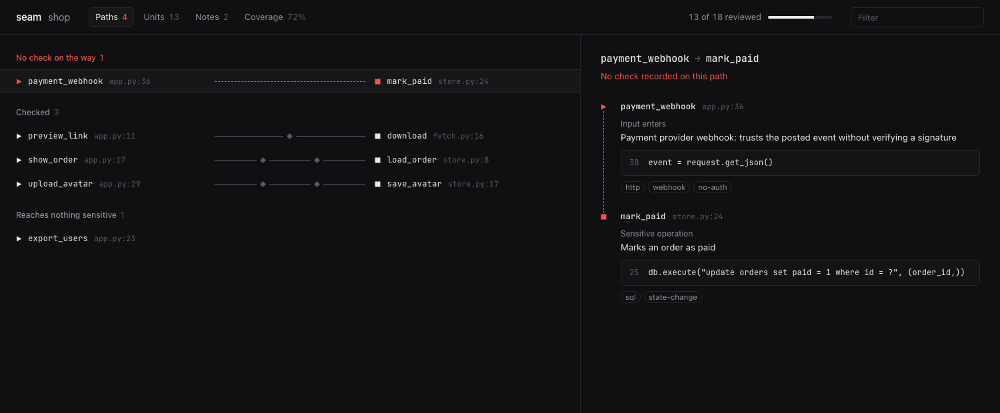

# seam

Tracks a security review of a codebase and checks every claim against the source.

I use AI agents to read code when I look for bugs. They're good at it, but the
same things kept going wrong. An agent reads the parts that look interesting and
never opens the rest, and it doesn't tell you which is which. It will say a
route checks permissions without having read the check. And the next session
starts from nothing.

Seam keeps the review in a file. It lists every function, method and file in
the repo, so you can see what hasn't been read. The agent records what each one
is and has to quote the code it's talking about. If that quote isn't in the
function, seam refuses the claim. The result is `.seam/map.json`, which you
commit with the code.



## Install

Download a binary from the
[releases page](https://github.com/0xWerz/seam/releases), or build it:

```sh
cargo install --git https://github.com/0xWerz/seam
```

## Try it

The repo has a small web app with a few holes in it.

```sh
cd examples/shop
seam scan
seam claim --stdin < claims.jsonl
seam gaps
seam view
```

`seam gaps` finds the one route that reaches something sensitive with no check
in front of it:

```
app.py#payment_webhook
    reaches store.py#mark_paid
```

Then try to record something that isn't true:

```sh
seam claim "app.py#payment_webhook" --kind guard \
  --summary "Verifies the provider's signature" \
  --quote 'verify_signature(request.headers["X-Signature"])'
```

```
seam: rejected: app.py#payment_webhook: quote was not found in this unit's source
```

## Claims

`seam show` prints a unit with what it uses and what uses it:

```
app.py#show_order
function, python, lines 17-20
uses:
  auth.py#require_login
  store.py#load_order

17 | @app.route("/orders/<order_id>")
18 | @require_login
19 | def show_order(order_id):
20 |     return jsonify(load_order(order_id))
```

You claim it by saying what it is and quoting the line that shows it:

```sh
seam claim "app.py#show_order" --kind guard \
  --summary "Requires a logged-in session, but never checks the order belongs to that user" \
  --quote "@require_login"
```

| Kind    | Meaning                                        |
| ------- | ---------------------------------------------- |
| `entry` | Untrusted input comes in here                  |
| `guard` | Something checks access or validates input     |
| `sink`  | An operation that shouldn't run unchecked      |
| `data`  | Sensitive data is defined, stored or returned  |
| `none`  | Read it, nothing here matters for security     |

The quote has to be inside the unit you're claiming. Whitespace can differ,
nothing else can. Quotes under eight characters are refused because they'd
match anywhere. `none` takes a summary and no quote.

## Commands

| Command                   | What it does                                                    |
| ------------------------- | --------------------------------------------------------------- |
| `seam scan`               | Lists every unit. Later runs only parse files that changed      |
| `seam status`             | How much is reviewed, overall and per directory                 |
| `seam next`               | What still needs review. `--reachable-from <id>` follows an entry point |
| `seam show <id>`          | A unit's source, connections, claims and notes                  |
| `seam claim`              | Records what a unit is, with a quote                            |
| `seam unclaim <id>`       | Removes claims                                                  |
| `seam link <from> <to>`   | Says one unit leads to another, with a quote                    |
| `seam unlink <from> <to>` | Removes a link, or cuts a connection seam got wrong             |
| `seam edges [path]`       | Lists the connections seam sees                                 |
| `seam note <id>`          | Attaches a note: idea, tested, dead-end or finding              |
| `seam notes`              | Lists notes                                                     |
| `seam unnote <id>`        | Removes the notes on a unit                                     |
| `seam gaps`               | Entry points that reach a sink with no guard. `--all` shows the guarded ones too |
| `seam diff <rev>`         | What changed since a git revision, and whether it was reviewed  |
| `seam verify`             | Checks every claim against the code as it is now                |
| `seam view`               | Opens the map as a web page                                     |
| `seam skill`              | Prints the instructions for an agent                            |

A unit is `path#Name`, like `src/auth.py#Login.check`. `path:line` works, and
so does a bare function name if only one function has it. A handler passed
inline to a call is named after that call, so the function in
`app.post("/users", requireAuth, (req, res) => ...)` is
`server.js#app.post:/users`.

`status`, `next`, `show`, `edges` and `gaps` take `--json`. `claim` and `link`
take `--stdin` to read a batch as JSON lines.

## Using it with an agent

The agent does the reading. Seam ships the instructions it needs.

Claude Code, as a plugin:

```
/plugin marketplace add 0xWerz/seam
/plugin install seam@seam
```

Or as a personal skill:

```sh
mkdir -p ~/.claude/skills/seam && seam skill > ~/.claude/skills/seam/SKILL.md
```

For Codex and other agents, add the instructions to the file your agent reads:
`seam skill >> AGENTS.md`.

Then ask for what you want, for example "map the security of this repo with
seam, starting from the HTTP routes".

## When the code changes

Each claim stores a hash of the unit it was made on. If the unit changes, it
comes back in `seam next` marked as changed since review. If the quoted line is
gone, the claim is stale, and `seam verify` lists it and exits with an error.

For a pull request, `seam diff main` lists what's new or changed and whether
anyone reviewed it:

```
new since main:
  app.py#purge_orders
      not reviewed

changed since main:
  app.py#download
      was sink, changed since: review again
```

Both can block a merge:

```yaml
- run: seam verify
- run: seam diff origin/main --check
```

Commit `.seam/map.json`. The rest of `.seam/` is rebuilt from the code and
ignored by git. More than one agent can work in the same repo: commands that
write take a lock.

## How units get connected

Seam connects two units when one names the other. That covers calls,
decorators, handlers passed to a router, callbacks and types, which is why it
works without knowing any framework. `seam show` lists these as "uses" and
"used by".

Matching by name gets things wrong, so seam only draws a connection when it
has a reason to:

- The two units are in the same language.
- If they're in different files, the caller's file imports the other one. A
  relative import means the nearest file with that name, so two copies of a
  module in one repo don't get mixed up.
- Words inside strings and on import lines don't count.
- A method called on a value, like `x.find()`, can't be resolved without
  types. Those show up in `seam show` as "may call" and are left out of paths.

When seam misses a real connection (a route table, a queue, dynamic dispatch),
add it with `seam link`. When it draws a wrong one, remove it with
`seam unlink` and it stays removed.

`seam gaps` works from what has been claimed so far. It tells you where to
look. It doesn't prove the rest is safe, and a path counts as guarded as soon
as any guard is recorded on it, whether or not it's the right one.
`seam gaps --all` shows which guard that was.

## Languages

Split into functions and methods: Rust, Python, JavaScript, TypeScript, Go,
Java, Ruby, PHP, C, C++ and C#.

One unit per file: Kotlin, Swift, Scala, Dart, Elixir, Solidity, Vue, Svelte,
SQL, shell, Terraform, YAML, TOML, Dockerfiles and HTML templates.

## License

MIT
